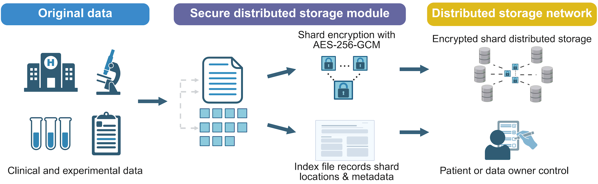

# BioLock: A Prototype System for Secure Distribution Storage of Biological Data

BioLock is a prototype end-to-end encrypted file storage system designed for sensitive biomedical data. It implements a "split-encrypt-distribute" paradigm by dividing files into multiple encrypted slices and generating a separate index file, ensuring that only the data owner can fully restore the original data. Built with Streamlit, BioLock provides an intuitive web interface, supports streaming upload of large files, user authentication, password reset, and file integrity verification. BioLock aims to offer researchers, clinicians, and patients a lightweight, secure, and easy-to-use data protection tool.

<div align="left">  </div>

> This is a corrected version of the original BioLock prototype by [KainMiA](https://github.com/KainMiA/BioLock). See the [Changelog](#-changelog) for what was fixed.

## ✨ Features

* End-to-End Encryption: Each data slice is independently encrypted with AES-256-GCM. Every slice is authenticated together with its file ID and position, so tampering, reordering or truncating slices is detected.
* Chunked Storage: Large files are split into adjustable slices (1–500 MB) and processed in a streaming fashion, making it memory-friendly.
* User Authentication: bcrypt password hashing; each user's encryption key is a random 256-bit key that is stored only in wrapped (encrypted) form and unlocked with a PBKDF2-HMAC-SHA256 key derived from the password (600,000 iterations).
* Safe Password Changes: changing the password re-wraps the key, so files stored with "Use my password" stay readable.
* Recovery Key: shown once at registration; with it, a forgotten password can be reset without losing access to encrypted files.
* Flexible Key Management: Users can use their password key, a generated custom key, or a custom passphrase, decoupling the encryption key from the password.
* Integrity Verification: every slice is verified on restore (AES-GCM authentication for encrypted slices, SHA-256 for plain ones); the output is only written to its final name once everything checks out.
* Large File Support: Streaming storage/restore handles files far exceeding available RAM (tested with 120 GB data).
* User-Friendly Interface: Built with Streamlit, featuring a dashboard, file manager, key manager and settings. Light/dark theme can be switched from Streamlit's menu (⋮ → Settings → Theme).
* Open & Transparent: Fully open-source code with auditable cryptographic logic, meeting academic reproducibility requirements.

## 📦 Technology Stack

* Backend: Python 3.9+ (3.11 recommended)
* Cryptography: cryptography (AES-GCM, PBKDF2), bcrypt
* Web Framework: Streamlit 1.50+ (on Python 3.9, pip installs Streamlit 1.50, the last release that supports it)
* Data Persistence: Local file system (JSON indexes + encrypted slices)

## 🚀 Quick Start

### Installation
1. Clone this repository (copy its URL from the green **Code** button on GitHub), or download it with **Code → Download ZIP** and unzip it
```
git clone <repository URL>
cd <repository folder>/BioLockApp_20260309
```
2. Create a conda environment
```
conda create -n biolock python=3.11
conda activate biolock
```
(An existing `python=3.9` environment from the earlier instructions also works.)
3. Install dependencies
```
pip install -r requirements.txt
```
### Run
```
streamlit run app.py
```
After launching, open http://localhost:8501 in your browser to start using BioLock.

### Tests
```
python -m unittest discover -s tests -v
```

### Upgrading from the 2026-03-09 version

Your data lives in the `users/`, `indexes/` and `storage/` folders inside `BioLockApp_20260309`. (If you used to start BioLock from a different folder, those data folders are in that folder instead; point `BIOLOCK_DATA_DIR` at it, see Configuration below.)

1. Back up the `users/`, `indexes/` and `storage/` folders.
2. Get the new code as described in Installation above, and copy the three data folders into its `BioLockApp_20260309` folder.
3. Update the dependencies (an existing conda environment can be reused):
```
pip install -r requirements.txt --upgrade
```
4. Start BioLock and log in. Your account is upgraded automatically on the first login, and all existing files can still be restored with the same keys.
5. Open the **Keys** page and generate a **recovery key** (older accounts don't have one yet), then save it somewhere safe.

After an account has been upgraded, the old version of BioLock can no longer log in to it.

### Configuration (optional)

Settings are read from environment variables or from a `.env` file next to `app.py`.

| Variable | Meaning |
| --- | --- |
| `BIOLOCK_DATA_DIR` | Where `users/`, `indexes/` and `storage/` are kept (default: the app directory) |
| `BIOLOCK_SMTP_HOST`, `BIOLOCK_SMTP_PORT` | SMTP server for password-reset emails (port 587 uses STARTTLS, 465 uses SSL) |
| `BIOLOCK_SMTP_USER`, `BIOLOCK_SMTP_PASSWORD` | SMTP login (optional) |
| `BIOLOCK_SMTP_FROM` | Sender address |

Without SMTP settings, the password-reset page runs in **demo mode** and shows the verification code on screen. In that mode anyone who knows an account's email address can reset its password (they still cannot decrypt files without the recovery key or the file keys), so configure SMTP before sharing a BioLock instance with others.

## 📖 User Guide

1. Registration & Login
* First-time users need to register (username, email, password).
* After registering, **save the recovery key** that is shown (copy it or download it). It is displayed only once; a new one can be generated on the Keys page.
* After login, your encryption key is unlocked with your password and kept in the session.

2. Store Files
* Go to the Store Files page.
* Choose upload mode: Standard Upload (≤200 MB, through the browser) or Large File Upload (enter the path of a file on the computer running BioLock; any size).
* Select a file and adjust the slice size (default recommended based on file size).
* Choose encryption method:

  Use my password: encrypt with the key protected by your login password.

  Custom key: paste a key generated on the Keys page, or type a passphrase (at least 8 characters). Custom keys are never stored — keep them safe.

* Click "Store File" and wait for completion. The system will display a file ID and encryption status.

3. Restore Files
* Go to the Restore Files page and select a file from the list.
* Specify the output directory on the computer running BioLock; if the file is encrypted, choose the key it was stored with (the right option is preselected).
* Click "Restore File" and wait. The restored file will be saved to the specified path; files up to 200 MB can also be downloaded through the browser.

4. Key Management
* On the Keys page, you can view your password key, generate new custom keys (copy/download supported), and create a new recovery key.

5. Settings
* On the Settings page, you can update your profile or change your password. Changing the password keeps all files accessible.

6. Forgotten Password
* On the login page, use "Reset Password": enter your email, then the verification code, a new password and your recovery key.
* Without the recovery key a new encryption key is created, and files stored with "Use my password" can no longer be restored with the password (unless you saved the password key itself from the Keys page and use it as a custom key).

## 🔒 Security Notes

* BioLock is designed to run on the machine that holds the data (e.g. `localhost`). The Large File Upload and Restore pages read and write paths on that machine, so do not expose an instance to untrusted users.
* File names, sizes and slice counts are stored unencrypted in the index files.
* Data from the original 2026-03-09 version is still readable: old accounts are migrated automatically at their next login (the plain copy of the key that the old version kept in `users/*.json` is removed), and old encrypted/plain files can still be restored.

## 📝 Changelog

### 2026-10 update
* Fixed: the app crashed for every new browser session or page refresh.
* Fixed: password reset always failed, even with the correct verification code.
* Fixed: changing or resetting the password made files encrypted with "Use my password" unrecoverable (keys are now wrapped; recovery keys added).
* Fixed: the password-derived key was stored in plain text in `users/*.json`.
* Fixed: "Recent Files" showed the oldest files; the restore form ignored switching to "Custom key"; storing the same upload twice produced an empty file.
* Security: slices are bound to their file and position (tamper/reorder/truncation detection), no plaintext hashes in indexes of encrypted files, username validation, secure reset codes with attempt limits, optional SMTP delivery.
* Restores are written atomically; failed uploads no longer leave orphaned slices; custom keys can be passphrases.
* Removed unused dependencies; added automated tests.
